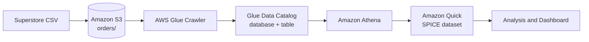

# Superstore Data Analysis: End-to-End Data Engineering on AWS

An end-to-end, serverless analytics pipeline on AWS. Raw Superstore sales data is stored in Amazon S3, cataloged with AWS Glue, queried with Amazon Athena, and visualized in Amazon Quick (formerly QuickSight).

## Overview

This project shows how to take a flat CSV file from storage to a published business dashboard using managed AWS services, with no servers to maintain.

**What it covers**
- Storing raw data in an S3 data lake
- Discovering the schema automatically with a Glue crawler
- Querying data in place with Athena (SQL)
- Building and publishing dashboards in Amazon Quick, with SPICE for in-memory speed
- Configuring IAM and service permissions correctly, and documenting the problems hit along the way

## Architecture



| Stage | Service | Purpose |
|---|---|---|
| Store | Amazon S3 | Holds the raw CSV under an `orders/` folder |
| Catalog | AWS Glue (crawler + Data Catalog) | Detects the schema and creates the `orders` table |
| Query | Amazon Athena | Serverless SQL over the data in S3 |
| Visualize | Amazon Quick (QuickSight) | Imports data into SPICE, builds visuals and dashboards |
| Secure | AWS IAM | Roles and policies for Glue, Athena and Quick to read the bucket |

## Dataset

The Superstore sales dataset (orders for a retail business). Main fields in the `orders` table:

| Group | Columns |
|---|---|
| Order | `order id`, `order date`, `ship date`, `ship mode`, `row id` |
| Customer | `customer id`, `customer name`, `segment` |
| Location | `region`, `state`, `postal code` |
| Product | `product id`, `product name`, `category`, `sub-category` |
| Measures | `sales`, `quantity`, `discount`, `profit` |

> Source: [add the dataset link here, e.g. Kaggle]

## Setup

**Region:** `ap-southeast-2` (Sydney). Keep every resource in one region, otherwise they will not appear together in the console.

1. **Create the S3 bucket** and upload the CSV into an `orders/` folder:
   `s3://superstore-analysis-<account-id>/orders/`
2. **Create an IAM role for Glue** with the AWS managed `AWSGlueServiceRole` policy plus a custom policy that allows read access to the bucket (`s3:ListBucket` on the bucket, `s3:GetObject` on `orders/*`).
3. **Create a Glue database**, then a **crawler** pointing at `s3://superstore-analysis-<account-id>/orders/`. Run it on demand and confirm a table is created under Data Catalog > Tables.
4. **Query in Athena.** Select the database and run a test query:
   ```sql
   SELECT * FROM orders LIMIT 10;
   ```
5. **Allow Amazon Quick to read S3.** In Quick, open Manage Account > Permissions > AWS resources, then tick Amazon S3 (select the bucket) and Amazon Athena.
6. **Create the dataset** in Quick from Athena, import to SPICE, then build an analysis and publish it as a dashboard.

## Dashboard

Visuals built so far:
- Sales by category (horizontal bar chart)
- [Add: profit by region, sales trend over time, top products, and so on]

Screenshots live in [`superstore_dataanalysis_images/`](superstore_dataanalysis_images/):

```

```

## Key Insights

> Fill this in from your dashboard, for example: top-selling category, most profitable region, products with negative profit.

## Repository Structure

```
.
├── README.md
├── Troubleshooting.md
└── superstore_dataanalysis_images/
```

## Troubleshooting

Real issues hit while building this, with causes and fixes, are logged in [Troubleshooting.md](Troubleshooting.md). Highlights:

- **Glue AccessDenied for an IAM user:** a new IAM user has no permissions until policies are attached.
- **Crawler succeeded but created 0 tables:** the S3 policy used the wrong resource ARN (`s3:ListBucket` needs the bucket ARN, not a folder path).
- **Quick dataset import failed with `s3:ListBucket` denied:** the Quick service role, not the IAM user, needed access to the bucket.
- **QuickSight appears as "Amazon Quick":** the service was renamed; the BI features are unchanged.

## Cost Notes

- The Glue crawler is billed only while it runs, so it is set to run on demand with no schedule.
- The Glue Data Catalog is free up to 1 million objects and 1 million requests per month.
- Athena bills by data scanned and S3 by storage, both very small for this dataset.
- Set an AWS Budget alert and delete unused resources after each session.

## Future Improvements

- Convert the CSV to partitioned Parquet with a Glue ETL job to cut query cost
- Orchestrate refreshes with Step Functions or EventBridge
- Add data quality checks
- Load curated data into Redshift for a warehouse layer

## Author

**Moe Arkar Zaw**
[LinkedIn](https://www.linkedin.com/) · [GitHub](https://github.com/)
